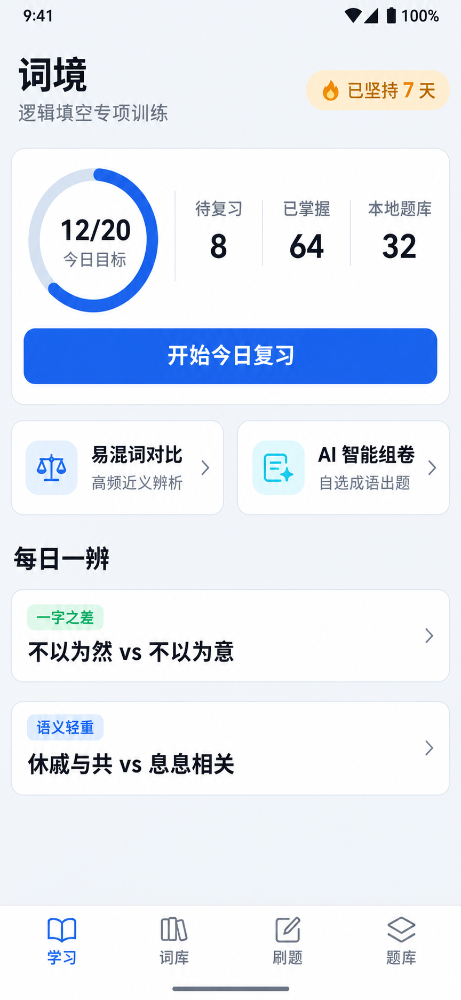
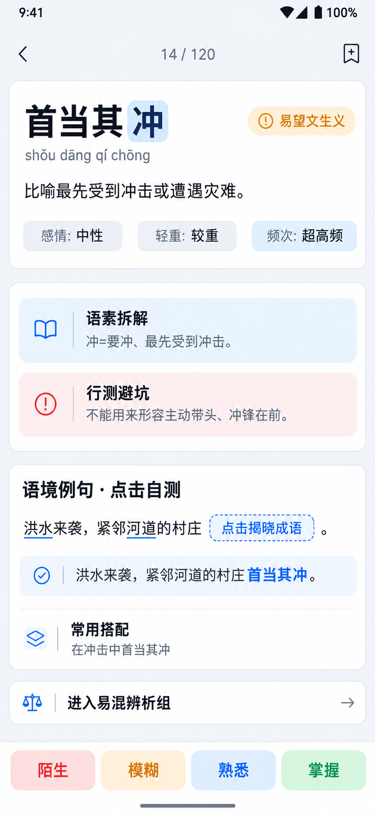
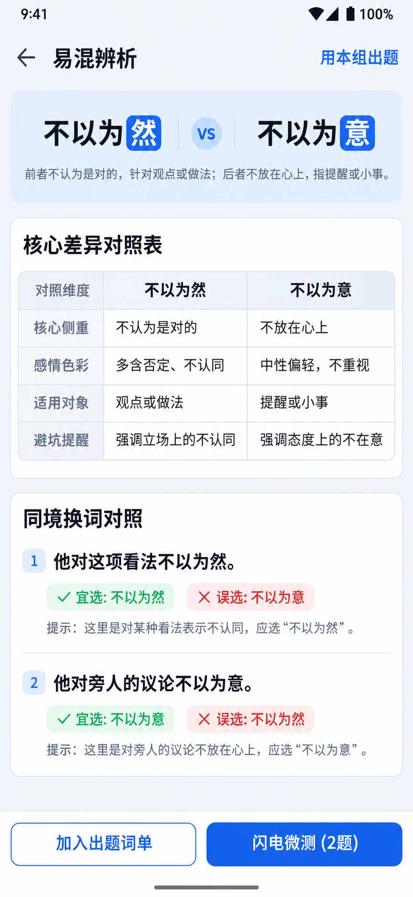
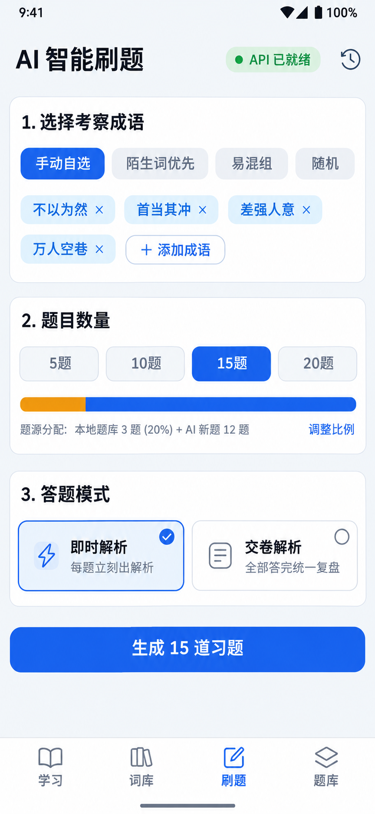
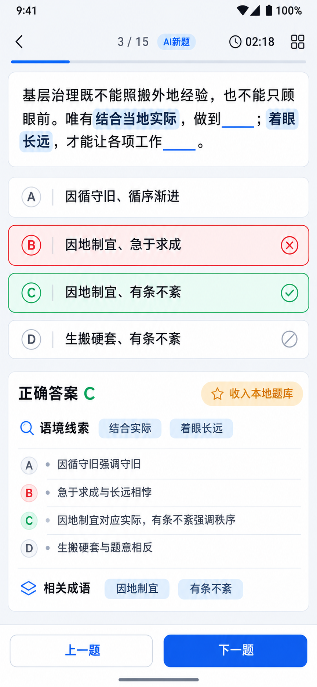
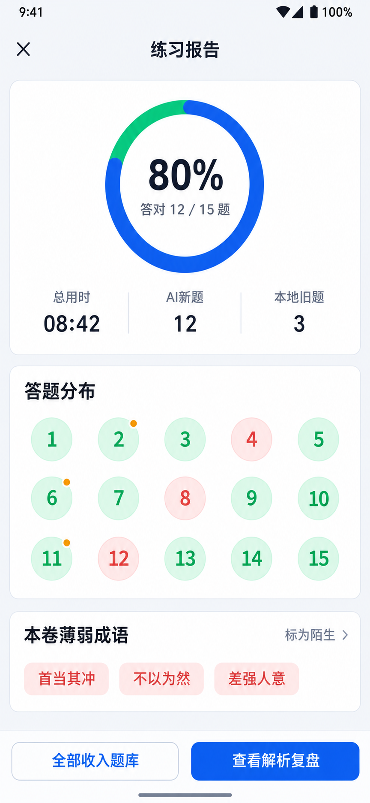
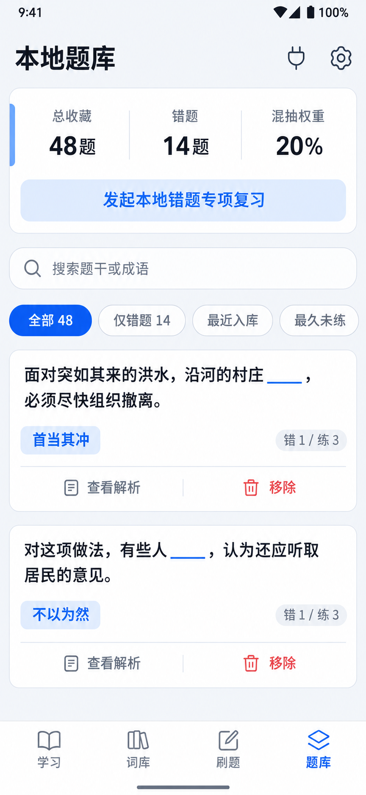
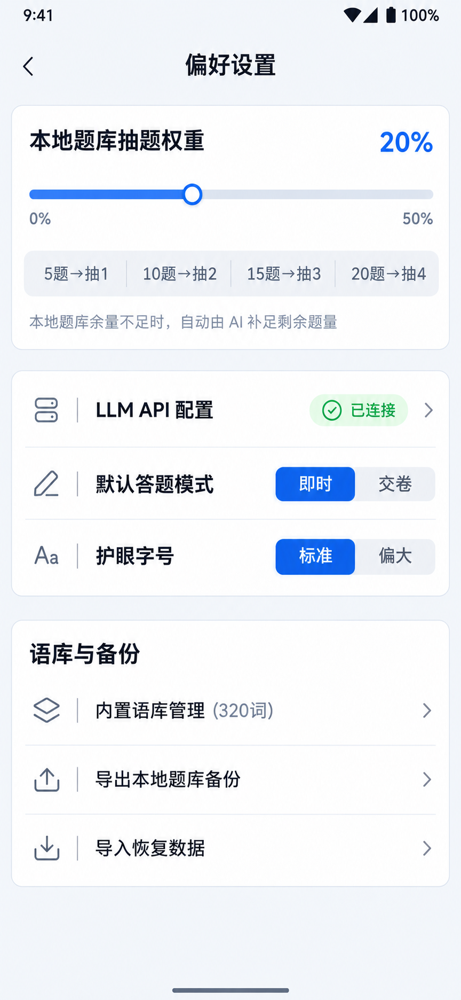

<div align="center">
  

  <h1>词境 · 行测逻辑填空</h1>

  <p>
    <strong>面向公务员 / 事业单位《行测 · 言语理解 · 逻辑填空》的移动端离线背词、易混辨析与 AI 智能刷题工具</strong>
  </p>

  <p>
    <a href="release/cijing-v1.0.0-release.apk">
      
    </a>
    
    
    
  </p>

  <p>
    <a href="#-快速下载与上手">快速安装 APK</a> ·
    <a href="#-界面预览">界面预览</a> ·
    <a href="#-核心功能亮点">核心功能</a> ·
    <a href="#-本地开发与构建">本地构建</a> ·
    <a href="语库/SCHEMA.md">自定义扩展语库</a>
  </p>
</div>

---

## ✨ 为什么做「词境」？

行测《逻辑填空》的真正提分点**不是死背词典原文**，而是抓住 **核心语素、感情色彩、语义轻重、适用对象与易混近义词的细微差别**，并在真题语境中反复验证。

「词境」把 **墨墨背单词的记忆节奏**、**粉笔的移动端刷题手感** 与 **大模型动态命制真题感习题** 融为一体：

- **离线即开即学**：内置经结构化整理的 **1,000 个行测高频成语 + 150 组经典易混成语对比组**，地铁、排队、睡前断网也能随时刷词；
- **AI 靶向出题**：按需选词，接入任意 OpenAI 兼容大模型 API，一键生成 `5 / 10 / 15 / 20` 道贴合国考/省考风格的逻辑填空题与逐项解析；
- **本地题库闭环**：好题/错题随时收藏入库，后续组卷默认按 **20% 权重**（`5→1 / 10→2 / 15→3 / 20→4`，可自由调节 `0%~50%`）智能混抽旧题反复巩固。

---

## 📱 界面预览

> 清新护眼效率风设计（浅灰白底 `#F5F7FA` + 卡片分层 + 护眼青蓝主色），长时间刷题不累眼。

<table>
  <tr>
    <td align="center" width="25%">
      <br />
      <sub><b>首页学习看板</b><br />进度环 · 打卡 · 每日一辨</sub>
    </td>
    <td align="center" width="25%">
      <br />
      <sub><b>成语六维理解卡</b><br />语素高亮 · 遮罩自测</sub>
    </td>
    <td align="center" width="25%">
      <br />
      <sub><b>易混成语对比</b><br />异字标亮 · 差异矩阵</sub>
    </td>
    <td align="center" width="25%">
      <br />
      <sub><b>AI 智能组卷</b><br />选词 · 题量 · 题源配比</sub>
    </td>
  </tr>
  <tr>
    <td align="center" width="25%">
      <br />
      <sub><b>沉浸式刷题</b><br />即时解析 · 一键入库</sub>
    </td>
    <td align="center" width="25%">
      <br />
      <sub><b>练习报告</b><br />正确率 · 薄弱成语汇总</sub>
    </td>
    <td align="center" width="25%">
      <br />
      <sub><b>本地题库</b><br />错题专练 · 检索复盘</sub>
    </td>
    <td align="center" width="25%">
      <br />
      <sub><b>权重与备份设置</b><br />抽题滑块 · 数据导入导出</sub>
    </td>
  </tr>
</table>

---

## 🎯 核心功能亮点

### 1. 成语「六维深度理解」与间隔复习
- **关键语素拆解**：彩色高亮决定词义的核心单字（如「首当其**冲**」标亮“冲=要冲”），直击望文生义误区；
- **行测属性标签**：感情色彩（褒/贬/中性）、语义轻重、高频星级与行测避坑提醒一目了然；
- **主动回忆例句**：例句中自动挖空遮罩，点击翻卡揭晓，并高亮上下文语境线索词；
- **四级掌握度打卡**：`陌生 / 模糊 / 熟悉 / 掌握`（自动计算 `10 分钟 / 1 天 / 3 天 / 7 天` 简化间隔复习队列），实时联动首页看板。

### 2. 易混成语「四重对比辨析」
- **异字高亮**：一屏醒目标出同组 2~4 个易混词的分叉字素（如 `不以为然 vs 不以为意`）；
- **核心差异对照表**：横向对比侧重点、感情色彩、适用对象与常见误区（多词组自动横向平滑滚动）；
- **同境换词对照**：用最小对立语境直观展示「宜选 / 误选」及判断线索；
- **闪电微测**：学完对比组立刻弹出二选一快速小测，答错自动回流复习队列。

### 3. 通用 OpenAI 兼容 LLM 智能出题
- **多模型通用接入**：自定义 `Base URL / API Key / Model`（支持 DeepSeek、通义千问、智谱、豆包及任意 OpenAI 兼容接口），密钥仅存储在手机本地；
- **原生防跨域直连**：Android 端自动通过 `CapacitorHttp` 原生通道请求接口，彻底规避 WebView CORS 限制；
- **行测 Prompt 工程与强容错**：支持 `国考真题风 / 省考风 / 基础巩固` 三档命题风格，自动剥离 `<think>` 思考标签、大题量（`15 / 20` 题）分批生成防 JSON 截断、解析异常自动重试。

### 4. 双模式刷题 + 本地题库权重闭环
| 答题模式 | 核心体验 |
| :--- | :--- |
| **即时解析模式** | 选完 A/B/C/D 立刻锁定高亮正误，展开语境线索、逐项辨析与关联词卡，单题一键「收入本地题库」 |
| **交卷解析模式** | 模拟实战不提前泄题，支持**选项划线排除**、标旗记号、底部答题卡任意跳题与计时，交卷后统一复盘与批量入库 |

- **默认 20% 权重智能混抽**：出 `5 / 10 / 15 / 20` 道题时默认自动从本地题库抽取 `1 / 2 / 3 / 4` 道旧题（设置页支持 `0% ~ 50%` 自由调节）；
- **优先级排序**：优先抽「命中本次选词 → 历史答错 → 最久未练」的本地旧题，库存不足时自动由 AI 实时补足；
- **指纹去重与备份**：基于题干与选项生成 64 位指纹自动防重复入库；支持个人学习记录与题库 JSON 导出备份（默认脱敏剔除 API Key）与恢复，以及 App 内热导入外部语库 JSON。

---

## 📦 快速下载与上手

1. **下载安装包**：直接下载仓库中的已签名 Release APK 👉 **[release/cijing-v1.0.0-release.apk](release/cijing-v1.0.0-release.apk)**（约 5.9 MB，已内置 1,000 成语 + 150 组易混词）。
2. **离线背词与辨析**：安装打开后无需联网即可直接使用 **学习 / 词库 / 易混对比** 全部离线功能。
3. **开启 AI 智能出题**：点击底部 **题库 → 右上角接口图标（LLM API 配置）**，填入你的 OpenAI 兼容 `Base URL`、`API Key` 与 `Model`，点击「测试连接」通过后保存即可组卷刷题。

---

## 🛠️ 技术架构

| 层级 | 选型 | 说明 |
| :--- | :--- | :--- |
| 前端框架 | React 18 + TypeScript + Vite | 轻量快速、强类型约束 |
| 样式体系 | Tailwind CSS + CSS Tokens | 清新护眼效率风、安全区自适应 |
| 状态与路由 | Zustand + React Router v6 (`HashRouter`) | 完美兼容 Android WebView 本地加载 |
| 离线存储 | IndexedDB（Dexie.js） | 6 张本地表支持千级词库检索与离线持久化 |
| 原生封装 | Capacitor 6（Android） | `CapacitorHttp`、状态栏、物理返回键防误退、自适应图标与启动封面 |

---

## 💻 本地开发与构建

### 环境要求
- Node.js `>= 20`
- 如需编译 Android APK：OpenJDK 17 + Android SDK（`platforms;android-34`、`build-tools;34.0.0`）

### 1. 安装依赖与本地预览
```bash
npm install
npm run dev
```
> `predev` / `prebuild` 会自动执行 `npm run sync:vocab`，校验并合并 `语库/*.json` 为运行时语库资源。

### 2. 类型检查与生产构建
```bash
npx tsc --noEmit
npm run build
```

### 3. 同步并打包 Android APK
```bash
npx cap sync android
cd android

# 构建 Debug APK
./gradlew assembleDebug

# 构建签名 Release APK（需先在 android/keystore.properties 配置签名证书信息）
./gradlew assembleRelease
```

---

## 📂 项目目录结构

```text
.
├── src/
│   ├── pages/               # 13 个核心路由页（对应 UI-01 ~ UI-14）
│   ├── components/          # 布局壳、通用 UI 组件、闪电微测与答题卡抽屉
│   ├── services/            # learningService / llmClient / quizEngine / backupService
│   ├── db/                  # Dexie.js 离线数据库定义与初始化
│   ├── native/              # Capacitor Android 状态栏与物理返回键桥接
│   └── styles/              # 全局设计系统 CSS Tokens
├── 语库/                     # 1,000 个成语 + 150 组易混词源 JSON 及 SCHEMA.md 规范
├── docs/                    # 项目路线图、16 张 UI 设计稿与分阶段任务书
├── scripts/                 # 语库校验合并脚本与 Android 图标/启动图生成脚本
├── app封面/                  # App 图标与启动封面源图
├── android/                 # Capacitor Android 原生工程（密钥与本地配置已 gitignore）
└── release/                 # 可直接安装的已签名 Release APK
```

---

## 📚 扩展语库

你可以按照 [语库/SCHEMA.md](语库/SCHEMA.md) 的 JSON 格式继续补充更多高频成语或易混对比组：
- **开发期扩充**：将新的 `idioms_*.json` 或 `confusion_groups_*.json` 放入 `语库/` 目录，重新 `npm run build` 即可自动校验合并；
- **手机端热导入**：直接在 App 内打开 **设置 → 内置语库管理 → 导入外部语库 JSON**，无需重新打包 APK。

---

<div align="center">
  <sub>祝备考顺利，行测言语稳步提分！</sub>
</div>
